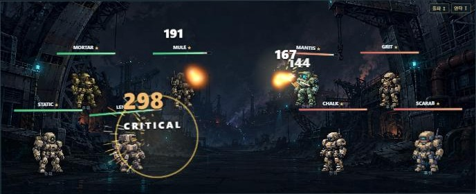

# 난투 무대 배경 의뢰서 — 2026-10-08 · Claude(main) → ChatGPT

사용자 결정(2026-10-08):
- 난투 재생을 카드 판에서 **무대형**으로 바꿨다. 사용자 판정은 "훨씬 낫다".
- **배경은 난투에 어울리는 그림으로 바꾼다. ChatGPT 가 그린다.**

그림이 들어오면 Claude 가 CSS 한 줄을 바꿔 연결하고 PC · 모바일 크롭을 맞춘다. ChatGPT 는 **그림만** 넣으면 된다.

## 지금 화면과 문제



`docs/art/review/brawl-stage-now-2026-10-08.jpg` — 지금은 1:1 대전 배경 `assets/backgrounds/battle-industrial-ruins.webp` 를 빌려 쓰고 있다.

문제는 세 가지다.
1. **바닥이 아래 30% 밖에 없다.** 뒷줄(후위가 아니라 화면 안쪽 줄) 기체 넷이 건물 · 크레인 앞에 **떠 있는 것처럼** 보인다. 난투는 한쪽에 넷씩, 두 줄로 선다 — 두 줄이 다 **같은 바닥을 딛고** 서야 한다.
2. **기체 뒤가 너무 복잡하다.** 녹슨 갈색 구조물이 기체(모래 · 베이지 · 회색 픽셀 로봇)와 색이 겹쳐 실루엣이 묻힌다.
3. **1:1 대전과 같은 그림이라 '난투에 들어왔다'는 느낌이 없다.**

## 난투가 무엇인가 — 그림의 주제

- 4 대 4 비동기 대전. 런(최대 10승 · 목숨 3) 동안 보급 상점에서 기체를 사서 배치하고 라운드마다 다른 플레이어의 편성과 싸운다. 주간 순위가 있다.
- 분위기 제안: **지하 격납고를 개조한 기체 투기장(피트).** 철판 바닥의 넓은 경기장, 둘레에 난간 · 캣워크 · 관중석 구조물(사람 없이 작은 불빛만), 위에서 내려오는 투광등.
- **좌우 진영 조명** — 왼쪽(아군)은 차가운 청록, 오른쪽(상대)은 붉은 주황. 지금 체력 막대가 아군 초록 · 상대 빨강이라 같은 축이다. 은은하게, 바닥에 번지는 정도로만.
- 바닥 가운데에 진영을 나누는 **중앙선** 정도의 표시는 좋다. **칸 표시(동그라미 · 사각 칸)는 그리지 않는다** — 칸 위치는 코드가 바꿀 수 있다.

## 배치 — 반드시 지킬 것

최종 그림 기준(16:9, 1920×1080). 화면에서는 `background-size:cover` 로 잘린다.

```
y  0% ┌──────────────────────────────────────────────┐
      │  천장 · 투광등 · 관중석 구조물 (어둡게)        │  ← 위 구석에 시너지 칩(작은 글자) 이 얹힌다
 ~38% │────────── 경기장 안쪽 벽 · 수평선 ─────────── │
      │  뒷줄 기체가 서는 바닥  (y 45~58%)             │
      │  아군 x 12~40%       중앙 x 40~60%   상대 x 60~88%
      │  앞줄 기체가 서는 바닥  (y 75~92%)             │
y100% └──────────────────────────────────────────────┘
```

- **바닥(경기장)은 y 40% 아래 전부.** 원근이 보이는 넓은 평면이어야 한다. 뒷줄 · 앞줄이 같은 바닥 위에 서도록.
- **바닥은 어둡고 차분하게(중간 명도 이하 · 대비 낮게).** 기체 · 흰 피해 숫자 · 금색 치명타 링 · 탄환 불빛이 얹힌다. 기체가 서는 자리에 밝은 반점 · 강한 선 · 문자가 없게.
- **가운데 x 40~60% 는 비워 둔다.** 탄이 날아가고 기체가 돌진하는 길이다. 소실점 섬광 · 큰 구조물 금지.
- **큰 구조물 · 밝은 디테일은 위쪽(y 0~35%)과 좌우 끝(x 0~8%, 92~100%)에만.**
- 좌우는 대체로 대칭이 좋다(두 진영이 공정하게 보이게). 완전 거울상일 필요는 없다.
- **잘림** — PC 무대는 약 2.45:1 이라 위아래가 잘린다(대략 y 14~88% 가 보인다). 모바일은 거의 정사각형이라 좌우가 잘린다(대략 x 22~78%). 두 경우 모두 바닥 두 줄이 보이고 화면이 성립해야 한다.

## 톤 · 형식

- 기존 배경과 같은 세계 — 어두운 SF, 남색 흑철 `#0b0f1a ~ #1a2b4e`, 청록 `#7bf0ff` 포인트, 아주 적은 호박색. 손으로 그린 듯한 하드서피스 환경 원화. 대문 `gate.webp` · 뽑기 `gacha.webp` · 격납고 `hangar.webp` 와 나란히 놓아 어색하지 않게.
- **인물 · 로봇 · 기체 · 차량 · 로고 · 읽히는 글자 · 숫자 · UI 틀 금지.** 전광판이 있다면 꺼져 있거나 문자 없는 빛만.
- 밝은 파스텔 · 만화풍 금지. **스크립트로 만든 그림은 반려**(2026-09 아트 디렉션 결정) — 이미지 생성으로 그리고 사람이 고른 것만.
- 파일: **`assets/backgrounds/brawl-arena.webp`** · 1920×1080 · 불투명 RGB. 원본 PNG 는 `docs/art/review/` 에 두거나 기록에 경로를 남긴다. 변환은 대문 · 뽑기 배경 때처럼(LANCZOS · WebP q88 · 300KB 안팎). **PNG 를 `assets/` 에 두지 않는다** — `tools/webp_assets.py` 가 무손실로 바꿔 수 MB 가 된다.
- 기록: `docs/art/brawl-arena-2026-10-xx.md` 에 최종 프롬프트 · 원본 경로 · 크기 · 해시 · 고른 이유(후보가 여럿이면 버린 이유도).

## 먼저 볼 것

1. **로컬 난투 미리보기**(운영 DB 와 무관, 메모리 SQLite):
   `node --no-warnings tools/ui-preview.mjs 8807 --sample-brawl` → `http://127.0.0.1:8807`
   대전 화면 왼쪽 `난투` → 대여 4기 선택 → `보상 런 시작` → 상점에서 몇 기 구매 → 대기석에서 전열 4칸에 배치 → `1라운드 출격`.
   무대가 재생된다(약 30초).
2. 배경을 바꿔 보려면 `themes/brawl-v2.css` 의 `.bs-stage` 에 있는 `battle-industrial-ruins.webp` 를 잠시 새 파일로 바꿔 보면 된다. **커밋은 그림 파일과 기록만** 하고, CSS 는 되돌린다 — 연결 · 크롭 조정은 Claude 가 한다.
3. 기체 위치(무대 높이 대비, 아래에서): 뒷줄 발 높이 44%, 앞줄 10%. 가로는 아군 10 · 18 · 30 · 38%, 상대는 좌우 대칭(`js/ui/brawl-view.js` `STAGE_X` · `STAGE_Y`).

## 생성 프롬프트 초안 (고쳐 써도 된다)

```text
Use case: stylized-concept. Create one premium finished raster background for ROWAR, a dark science-fiction mech battle web game. Full-bleed opaque 16:9 landscape illustration, target 1920x1080. Hand-painted hard-surface game environment art, deep midnight navy #0b0f1a to steel navy #1a2b4e, cool cyan #7bf0ff accents and very sparse warm amber. Environment only: no characters, robots, mechs, vehicles, logos, readable text, letters, numbers, HUD, UI panels or borders.
Scene: an underground mech fighting pit built inside a converted hangar, seen from a slightly elevated side-on camera like a 2D fighting game stage. A wide flat arena floor of dark worn steel plates fills the entire lower 60% of the image with gentle perspective, so two rows of fighters can stand on it (a back row around 45-58% height and a front row around 75-92% height). A faint painted center line divides the floor into left and right halves. The far arena wall and horizon sit around 38% from the top. Above it: dark catwalks, railings, empty spectator galleries with tiny scattered lights, heavy ceiling trusses and a few overhead floodlights casting soft pools onto the floor. Subtle team lighting: cool teal light spilling over the LEFT half of the floor, warm red-orange light over the RIGHT half, both restrained. Keep the floor dark, low-contrast and uncluttered, with no bright spots, symbols, circles or grid tiles where fighters stand. Keep the central vertical strip x=40%-60% calm with no glare or structures. Put large structures and bright details only in the top third and the far left/right edges. Roughly symmetrical composition. Must still read when cropped to a wide 2.45:1 band (y 14%-88%) and to a central square (x 22%-78%).
```

## 추가 결정 — 2026-10-08 밤 · 도트 그림으로 (사용자 확인 "해보자")

opencode(GPT) 1차 후보 3장(저장소에 올리지 않음)은 구도는 맞았지만 **기체와 따로 논다** — 기체는 도트 그림인데 배경은 매끈한 3D 렌더라서.
렌더를 뭉개 본 임시 시험은 더 붙었지만 원래 도트만큼 깔끔하지 않았다.

- **배경도 도트 그림(pixel art)으로 그린다.** 기체 그림과 같은 픽셀 크기 — 무대에서 기체 한 픽셀이 화면 약 1.5~2px 이므로 1920 폭 그림이면 **픽셀 한 칸이 4px 정도**(가로 약 480 칸). 색 수는 적게, 안티에일리어싱 · 사진 질감 · 렌더 광택 금지.
- **구도는 후보 1 을 따른다** — 2층 난간이 둘러싼 경기장, 넓은 철판 바닥, 좌 청록 · 우 주황 바닥 조명.
- **홀을 더 좁고 가깝게** — 1차 후보는 홀이 너무 커서 기체가 장난감처럼 작아 보였다. 안쪽 벽이 더 가깝고, 난간 · 문 같은 기준 물체가 기체 키(무대 높이의 약 1/3)와 어울리는 크기로.
- 발밑 그림자 · 기체 밝기 · 진영색 테두리빛은 Claude 가 코드로 넣는다(배경에 그리지 않는다).

## 완료 — 2026-10-08 밤 · 사용자 결정 "일단 1번으로 하자"

opencode(GPT)가 도트 후보 4장을 그렸고 사용자가 1번을 골랐다 → `assets/backgrounds/brawl-arena.webp` 로 연결했다. 기록: `docs/art/brawl-arena-2026-10-08.md`.
**이 의뢰는 닫는다.** 더 다듬고 싶으면 같은 이름 · 16:9 로 덮어쓰면 된다.
