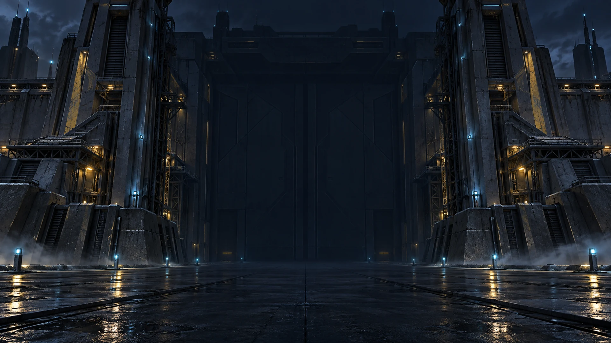
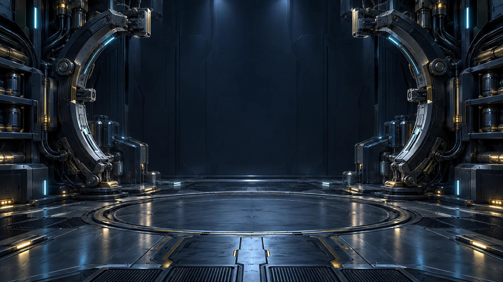
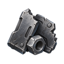
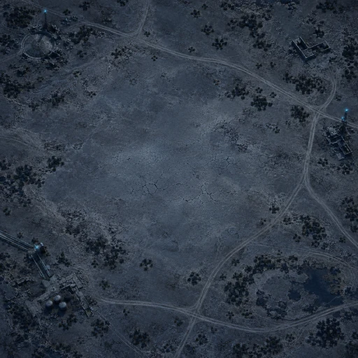
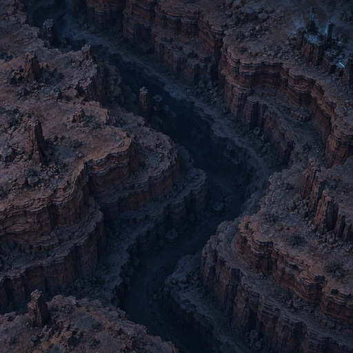
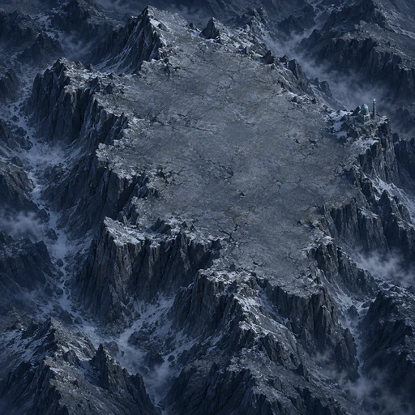
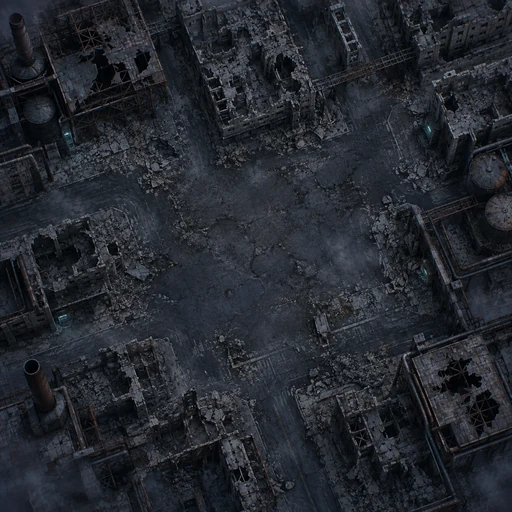
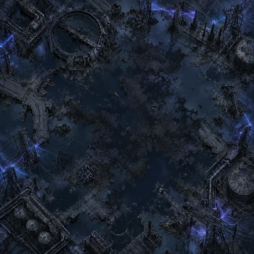
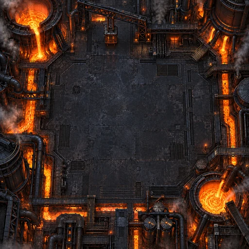

# 추가 이미지 11종 — 제작 완료·연결 인계 · 2026-09-11

사용자가 요청한 잔여 11종의 로컬 파일 제작을 완료했다. 이전 격납고까지 합하면 원래 그림 요청 5묶음·12파일이 모두 준비됐다. **게임 연결·배포 완료는 아니다.**

## 파일 목록

| 용도 | 파일 | 규격 | bytes |
|---|---|---|---:|
| 대문 | [assets/backgrounds/gate.webp](../../assets/backgrounds/gate.webp) | 1920×1080 WEBP | 246,098 |
| 뽑기 | [assets/backgrounds/gacha.webp](../../assets/backgrounds/gacha.webp) | 1920×1080 WEBP | 261,558 |
| 평원 | [assets/terrain/plain.webp](../../assets/terrain/plain.webp) | 512×512 WEBP | 74,788 |
| 협곡 | [assets/terrain/canyon.webp](../../assets/terrain/canyon.webp) | 512×512 WEBP | 60,766 |
| 고지 | [assets/terrain/highland.webp](../../assets/terrain/highland.webp) | 512×512 WEBP | 83,030 |
| 폐허 | [assets/terrain/ruins.webp](../../assets/terrain/ruins.webp) | 512×512 WEBP | 75,934 |
| 자기폭풍 | [assets/terrain/storm.webp](../../assets/terrain/storm.webp) | 512×512 WEBP | 70,548 |
| 용광로 | [assets/terrain/furnace.webp](../../assets/terrain/furnace.webp) | 512×512 WEBP | 88,806 |
| 크레딧 | [assets/ui/coin-credit.png](../../assets/ui/coin-credit.png) | 128×128 PNG | 18,536 |
| 코어 | [assets/ui/coin-core.png](../../assets/ui/coin-core.png) | 128×128 PNG | 12,854 |
| 스크랩 | [assets/ui/coin-scrap.png](../../assets/ui/coin-scrap.png) | 128×128 PNG | 20,566 |

추가 11종 합계 **1,013,484 bytes (약 0.97 MiB)**. 기존 격납고는 별도 [제작 기록](hangar-2026-09-11.md)을 본다.

## 검수와 원본

- 내장 ImageGen으로 만든 개별 원화. 이번 재개에서는 기존 원화 10개를 재사용하고 누락 용광로 1개만 새로 생성했다. 원본은 모두 보존했다.
- 11파일 전부 디코딩·치수·형식·SHA-256 확인. PNG 3종은 RGBA, 알파 범위 0~255, 네 테두리의 알파 최댓값 0을 확인했다.
- 아이콘은 전체 원본을 124px로 줄여 128px 투명 캔버스에 2px 여백으로 배치했다. 마스크 없는 RGBA paste로 기존 알파를 보존했다.
- 프론트·서버·밸런스 코드는 변경하지 않았다. 이 검사는 이미지 파일 검수이며 게임 내 렌더링이나 운영 서버 점검이 아니다.
- [아이콘 프롬프트·원본·검수](remaining-icons-2026-09-11.md), [배경 프롬프트·원본·검수](remaining-backgrounds-2026-09-11.md), [평원·협곡·고지 기록](remaining-terrain-land-2026-09-11.md), [폐허·자기폭풍·용광로 기록](remaining-terrain-hazard-2026-09-11.md).

## Claude 연결 체크리스트

1. `.hg-stage` → 기존에 준비된 `hangar.webp`, `#gate` → `gate.webp`, `.gacha-stage` → `gacha.webp`. 새 원화가 기존 불투명 배경층 뒤에 숨지 않도록 구성한다.
2. `.ic-credit`·`.ic-core`·`.ic-scrap`에 PNG를 연결한다. 기존 지갑 아이콘은 16px이므로 16/24/32px에서 형태를 확인하고 원형 클리핑 없이 비율을 유지한다. 숫자·툴팁·접근 가능한 재화 이름은 유지한다.
3. `TERRAIN`의 키와 파일명이 동일하다. `n.terrain` 기준으로 지도 카드에 연결한다. 현재 `.tnode` 마크업에는 지형 속성이 없으므로 데이터 속성이나 배경 변수를 명시적으로 전달해야 한다.
4. 평원·협곡·고지·폐허·자기폭풍·용광로의 글자 뒤에 어두운 오버레이를 둔다. 고지는 중앙이 상대적으로 밝다. `mine/foe/locked/prot`의 식별색·잠금·보호 표시는 배경보다 위에 유지한다.
5. PC와 모바일 cover 크롭, 작은 아이콘, 지도 12칸, 캡슐 대기·충전·개방·결과를 확인한 뒤 배포한다. 외부 URL은 사용하지 않는다.

## 미리보기

### 대문 / 뽑기

| 대문 | 뽑기 |
|---|---|
|  |  |

### 재화

| 크레딧 | 코어 | 스크랩 |
|---|---|---|
|  |  |  |

### 지형

| 평원 | 협곡 | 고지 |
|---|---|---|
|  |  |  |

| 폐허 | 자기폭풍 | 용광로 |
|---|---|---|
|  |  |  |

