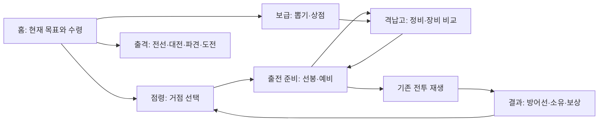

# ROWAR UI 개편 계획

작성: 2026-09-20 · 기준 커밋 `d3507f1` · 스키마 21 · 밸런스 `151i21l`

**상태: 사용자 시안과 현행 코드 조사를 반영한 실행 제안. 화면 구현·운영 반영은 아직 하지 않았다.**
사용자가 확정한 것은 계획 우선, PC·모바일 대응, 기존 기체 그림과 시스템 활용, 점령의 중요성이다. 아래 메뉴 구조·우선순위는 추천안이며, 뽑기 분리·파일럿·3~5기 확대는 미결정이다.

## 1. 게임의 중심과 완료 기준

**기체를 모으고 자기 방식으로 정비해, 거점을 공략하고 유지하는 메카 수집·전략 게임.**

UI 개편의 목표는 플레이어가 현재 상태를 읽고, 다음 목표를 고르고, 기체를 준비하고, 결과를 이해하는 과정을 매끄럽게 연결하는 것이다. 점령을 장기 목표로 드러내고, 전선은 세계관과 초반 진입, 대전은 경쟁, 파견은 성장 재료, 격납고는 전략 준비를 담당한다.

사용자가 말한 상용 게임의 완성도를 다음과 같이 판단한다.

- 첫 화면에서 내 기체, 현재 목표, 다음 행동을 이해할 수 있다.
- 크레딧·코어·스크랩을 쓰기 전에 비용과 결과의 성격을 안다.
- 기체 개성, 선봉·예비의 역할, 장비 교체의 효과가 화면에서 읽힌다.
- 화면을 옮겼다 돌아와도 선택 거점·기체·필터·스크롤이 유지된다.
- 정상 화면뿐 아니라 로딩·오류·빈 상태·보상 수령·잠김에도 같은 품질을 적용한다.
- PC의 넓은 정보 배치와 모바일의 엄지 조작을 각각 설계한다.
- 기존 밸런스 완료 상태를 유지한다. UI를 만들기 위해 성장 수치나 확률을 다시 조정하지 않는다.

## 2. 확인한 시안 9장과 적용 판단

원본 폴더: `C:\Users\DESKTOP-896744\Downloads\rowar_ui_rebuild`
각 파일에 PC와 모바일 구성이 함께 있다. 파일명만 읽은 것이 아니라 9장을 모두 시각적으로 확인했다. 원본은 이번 계획 문서에 복제하지 않았다.

| 시안 | 가져올 구성 | 현재 게임에 맞출 부분 |
|---|---|---|
| `login.png` | 브랜드·대표 비주얼·시작/계정의 분명한 구분 | 기존 게스트/계정 흐름 유지. 실제 기체 그림 사용. 없는 언어/전체화면 기능은 버튼부터 만들지 않는다 |
| `mainlobby_1.png` | 대표 기체와 빠른 이동, 짧은 진행 요약 | 일일 임무·시즌 이벤트·우편은 현행 기능이 아니므로 현재 원정/점령/전선/시련 진행으로 채운다 |
| `mainlobby_2.png` | **추천 기본안: 지도 중심의 지휘실** | 큰 지도는 점령 화면에서, 홈은 작은 작전 현황과 이어하기 중심. 5기 부대·세력·시즌 표시는 현행 데이터로 대체 |
| `occupation.png` | **최우선: 큰 지도, 선택 거점 패널, 지역 썸네일** | 12거점 개인 소유 규칙. 세력/동맹/인접 진군/시즌/예상 점령 시간은 새 시스템이므로 보류 |
| `hangar.png` | 보유 목록·큰 기체·상세/장비의 PC 3영역 | 실제 4슬롯, 6스탯, 5프리셋. 3D 뷰어·스킨·보조 무기 5번째 슬롯은 넣지 않는다 |
| `gatcha.png` | 배너, 획득 대상 미리보기, 비용·행동의 위계 | 코어/크레딧 2종 혼합 풀. 파일럿·픽업·천장·10연 보장은 현행에 없음 |
| `fight.png` | 대결 구도, 상대 정보, 전술과 출격 버튼 | 현재 1:1 전투와 실제 레이팅. 5:5·티어명·클랜은 추가하지 않는다 |
| `detachment.png` | 임무 카드, 시간/보상, 진행/수령 구분 | 원정은 1기·동시 1건. 토벌은 즉시 전투. 가속/일괄 파견/동시 3건은 별도 기획 |
| `ranking.png` | 상위권 강조, 내 순위, 간결한 목록 | 실제 제공되는 순위 항목만 사용. 클랜·가짜 시즌 집계·순위 변동을 꾸며 넣지 않는다 |

시안의 조밀한 작은 글씨, 반복되는 금속 프레임, 모든 구획의 발광은 실제 화면에서 줄인다. 배경의 깊이는 살리고 읽는 패널은 차분하게 만든다. PC 시안을 휴대폰 폭으로 축소하지 않는다.

## 3. 현행 시스템: 반드시 지킬 사실

| 모드 | 실제 투입 | 새 UI에서 보여줄 표현 |
|---|---|---|
| 전투 편성 | 최대 2기 | 선봉 / 예비 |
| 일반 대전·친선·토벌 | 선택한 1기 | 출전 기체 1기와 전술 |
| 주간 시련 | 선택한 1기 | 출전 기체와 기록 목표. 현행에는 전술 선택 없음 |
| 점령·전선·공동 레이드 | 최대 2기 순차 투입 | 선봉이 쓰러지면 예비가 이어받는 돌파 편성 |
| 시간형 원정 | 1기, 동시에 1건 | 원정 기체와 전투에 남는 기체 |

2기가 동시에 전장에 서는 전투가 아니다. 현재 `squad1/squad2`와 순차 1:1 돌파를 3~5기 동시 전투처럼 설명하지 않는다.

- 기체 30종, 몬스터 19종, 파츠 베이스 21종/도감 84칸, 파츠·슬롯 아이콘 25장.
- 파츠 슬롯은 무기·프레임·부스터·코어 4개. 능력치는 HP·공격·방어·속도·치명·회피 6종.
- 크레딧·코어·스크랩의 3재화. 뽑기 지불 방식은 코어/크레딧 2개.
- 뽑기는 두 방식 모두 기체와 파츠가 섞인다. 천장·픽업·파일럿 수집·10회 보장 없음.
- 점령은 개인 소유 12거점. 소유권, 방어선 체력, 보호, 등급/레벨 제한, 수입이 이미 존재한다.
- 전선 2장·삽화 44장, 주간 시련, 공동 레이드, 도감 활성화·칭호, 파츠 합성, 프리셋 5개, 조각 상점·보관함을 유지한다.
- 카드와 전투는 원본 PNG. 이그니스의 승인된 10프레임 모션은 격납고 큰 무대에서만 사용한다.

## 4. 추천 메뉴 구조와 기능 대응표

PC 주요 메뉴: **홈 · 격납고 · 점령 · 출격 · 보급 · 도감 · 랭킹**, 계정/설정은 별도 유틸리티.
모바일 하단: **홈 · 격납고 · 점령 · 출격 · 더보기**. 모든 화면에서 순서와 위치를 고정한다.
보급/도감/랭킹/설정은 더보기에서 접근하고 홈에는 뽑기·수령 바로가기를 둔다. 뽑기에 도달하는 경로는 홈에서 1번, 다른 화면에서는 최대 2번이다. 메뉴 발견성은 첫 사용 관찰에서 확인한다.

| 현재 기능 | 개편 후 위치 | 놓치면 안 되는 세부 기능 |
|---|---|---|
| 로그인·게스트·계정 | 타이틀 / 계정 | 기존 계정 인식, 로그인, 게스트 정식 전환, 저장 안내 |
| 격납고 | 격납고 → 기체/장비 | 선봉·예비, 레벨·스킬 강화, 정비·피로, 잠금/출전 불가 이유 |
| 파츠 관리 | 격납고 → 파츠 | 필터·정렬, 교체 전후 비교, 다른 기체 장비 이동, 개별/등급 분해, 합성 |
| 프리셋 | 격납고 → 장비 프리셋 | 계정 공용 4슬롯 파츠 조합 5개, 사라진 파츠 처리, 적용 결과. 기체·선봉·예비를 저장하는 기능은 아님 |
| 코어/크레딧 뽑기 | 보급 → 뽑기 | 1/10회, 확률, 중복 전환, 기존 캡슐 연출, 결과 |
| 진열 상점·조각·보관함 | 보급 → 상점/보관함 | 진열 갱신, 유료 갱신, 조각 조립, 실제 보관함 내용 |
| 점령 | **독립 주요 메뉴** | 12거점 지도, 방어선, 보호·강행, 제한, 수입 수령 |
| 전선 | 출격 → 전선 | 2장 진행, 삽화/대사, 다시 보기, 보상, 결과 정비 |
| 일반/친선/연습 대전 | 출격 → 대전 | 상대 검색, 상대 상세, 전술, 지목 대전, 오프라인 무보상 구분 |
| 토벌·원정 | 출격 → 파견 | 즉시 전투/시간형 임무 구분, 주간 토벌 잔여, 1기 원정 잠금/수령 |
| 주간 시련·레이드 | 출격 → 도전 | 주간 기록, 순위, 공동 보스 체력, 도전 제한, 기여도 |
| 도감·칭호 | 도감 | 기체/몬스터/파츠, 활성화, 이정표, 몬스터 4단계, 기존 숨김 정보 정책 |
| 랭킹 | 랭킹 | 실제 순위·내 위치·표시 가능한 기록 |
| 안내·티커·알림 | 공통 안내/상태 | 수령 가능 상태를 해당 화면으로 연결, 실제 행동 가능한 항목만 알림 표시 |

이것은 화면 이름과 접근 경로 제안이다. 기존 `gacha/hunt/terr` 등의 내부 키를 한꺼번에 바꿀 이유는 없다. 새 메뉴와 기존 동작 사이에 매핑을 둔다.

도감의 현재 숨김 정책을 보존한다: 달성 전 환급액과 이정표의 칭호명, 칭호 획득 조건/진행 수치는 숨긴다. 수령 후 환급 알림, 활성화 비용, 다음 이정표까지 남은 칸 수는 표시한다.

신규 계정은 기존 전선 진입 의도를 유지한다. 돌아온 사용자는 전선 이어하기, 원정 수령, 점령 현황 등 실제 진행에 맞는 행동을 홈에서 고른다. 플레이하지 않는 모드로 강제 이동시키지 않는다.

## 5. 먼저 완성할 점령 화면

### PC

- 상단: 재화와 공통 메뉴. 점령의 현재 수입/보유 수 요약.
- 중앙 약 60~70%: 세계 지도와 기존 12거점. 지형은 현재 거점 설정과 일치시킨다.
- 오른쪽: 선택 거점 정보와 행동 패널. 지도를 보면서 판단할 수 있게 상세 모달 의존을 줄인다.
- 보조 목록: 내 거점/공략 가능/전체 필터와 거점 목록. 지도를 사용하기 어려워도 동일 기능에 도달한다.
- 더 좁은 PC/태블릿에서는 지도+상세 2영역으로 줄이고 중복 요약을 접는다.

### 모바일

- 점령 요약 → 지도 → 선택 거점 요약의 순서.
- 탭하면 거점을 선택하고, 자세히 보기에서 하단 상세 패널을 연다. 선택만으로 자원을 쓰지 않는다.
- 지도 확대/이동, 전체 지도 복귀, 목록 보기 제공. 화면 자체의 스크롤을 지도 드래그가 빼앗지 않게 한다.
- 거점 선택 시 지도 위치 유지. 상세를 닫아도 선택 강조 유지.
- 주요 행동은 하단 안전 영역 위에 배치하며 내비게이션과 겹치지 않는다.

### 거점 정보의 읽는 순서

**이름·소유자·지형 → 도전 가능 여부 → 남은 방어선 → 선봉/예비와 상태 → 비용 → 보상/수입 → 행동.**

- 등급/레벨 미달, 원정 중, 기체 부족, 보호 중, 재화 부족은 원인과 해결 경로를 함께 표시한다.
- 방어 전력은 승률 보장이 아니다. 현재 서버에 없는 예상 승률·예상 점령 시간을 만들어 표시하지 않는다.
- 다른 지휘관의 보호를 코어로 강행할 때는 일반 출격과 구분하고 실제 비용을 확인시킨다.
- 내 거점에는 수입/수령과 보호 상태를 표시한다. 현행에 없는 수동 방어 배치·거점 강화 버튼을 추가하지 않는다.
- 공격 실패도 방어선에 남긴 피해를 결과에서 알려준다. 서버가 돌려준 값만 사용한다.
- 동시 점령으로 상태가 달라지면 최신 소유권·보호를 갱신하고 다시 판단하게 한다.
- 지도 범례는 **내 거점 / 다른 지휘관 / 몬스터**, 그리고 잠김·보호·선택 보조 표시. 색 외에 아이콘·문자를 함께 사용한다.
- 구역의 색면은 실제 거점 소유를 표현한다. 그림상의 길을 인접 점령 조건으로 오해하게 하지 않는다.
- 시즌·동맹 세력·행군·수입 외 새 지역 보너스는 현재 규칙에 없다. 이를 표현할 자리는 별도 확장 단계에서 설계한다.

## 6. 격납고와 홈의 품질 기준

격납고 PC는 보유 목록 / 큰 기체 / 상세·장비의 3영역, 모바일은 큰 기체 / 핵심 성격 / 선봉·예비 / 장비·성장의 순서로 구성한다.
모든 기체를 공격력 합계로만 비교하지 않는다. 현행 `role`과 실제 능력치를 사용해 공속형·치명형·방어형·회피형·스킬형의 차이를 한 문장과 비교표로 보여준다.

- 파츠 교체 전후를 같은 기체·레벨 조건에서 비교한다. `stats.js`를 사용하며 별도 계산식을 만들지 않는다.
- 장비 옮기기에는 어느 기체에서 빠지는지 표시한다. 다른 기체의 장비를 조용히 빼앗지 않는다.
- 무기·프레임·부스터·코어의 기존 25아이콘과 희귀도 체계를 사용한다.
- 분해·합성의 재료와 결과 성격을 먼저 보여주고, 프리셋 적용 결과도 확인할 수 있게 한다.
- 홈은 로비 2의 지도 중심 구성에 로비 1의 대표 기체·빠른 이동을 조합한다. 전체 점령 화면을 축소 복제하지 않는다.
- 홈 주 행동은 전선 이어하기/점령 보기 등 실제 진행에 맞춘다. 없는 일일 퀘스트와 시즌 카운트다운으로 공간을 채우지 않는다.

## 7. 뽑기와 3~5기 편성의 결정 기록

### 뽑기 분리

**추천: 첫 UI 개편에서는 코어/크레딧 2종 유지.** 기존 캡슐 연출, 실제 기체/파츠 미리보기, 획득 결과, 명확한 확률과 중복 안내를 시안의 배너 구조에 담는다.

| 선택 | 장점 | 함께 설계해야 하는 것 | 판단 |
|---|---|---|---|
| 현재 혼합 2종 유지 | 기존 성장·재화 흐름 유지, 빠른 화면 완성 | UI에서 두 방식의 차이를 읽히게 하기 | 1차 추천 |
| 기체/파츠 분리 | 원하는 종류를 목표로 획득 가능 | 두 재화와 풀의 관계, 확률, 수급, 중복 가치, 천장 여부·기존 계정 영향 | 별도 기획 후보 |
| 파일럿까지 추가 | 수집과 서사 확장 | 파일럿 고유 역할·기체와의 관계·그림·육성·획득·저장 전체 | 장기 후보 |

분리의 판단 기준은 캐릭터 숫자만이 아니다. 플레이어가 원하는 성장 재료를 얻기 어려운지, 분리 후 한쪽 풀이 사장되지 않는지, 업데이트를 지속할 제작 여력이 있는지를 먼저 확인한다.
시안의 `PICK UP`, `LIMITED`, SSR 천장, 10연 보장 문구는 실제 규칙이 결정·구현되기 전까지 쓰지 않는다.
종류별 1회 확률과 해당 종류가 나왔을 때의 조건부 등급 확률은 구분해 안내한다.

### 출전·파견 기체 수

**추천: 현재 1기/2기 규칙을 정확히 드러내고 3~5기는 별도 확장으로 판단.**

| 후보 | 바뀌는 영역 | 선행 질문 |
|---|---|---|
| 점령의 3기 순차 돌파 | 편성 저장, 피로·비용, 연속 전투, 재생, 난이도 | 세 번째 기체가 어떤 다른 선택을 만드는가? |
| 3기 지원 파견 | 원정 저장·기체 잠금·보상·성장 속도 | 주력 기체를 비우는 대가와 보상이 적절한가? |
| 5기 동시 전투 | 타깃·진형·범위·AI·전투 엔진·UI | 현재 1:1 자동 전투의 정체성을 바꿀 것인가? |

칸이 많아 보인다는 이유로 먼저 저장 구조를 늘리지 않는다. 필요한 경우 기존 계정의 보유·육성 부담과 신규 사용자의 확보 가능 기체 수를 포함한 별도 실험으로 정한다.

## 8. 시각 언어와 기존 그림 사용 규칙

- **톤:** 어두운 지휘실, 깊이 있는 전장 배경, 읽기 쉬운 불투명 패널. 질감은 배경/큰 표면 중심.
- **위계:** 한 화면에서 기체 또는 지도를 가장 먼저 보게 하고, 주 행동 1개를 명확히 둔다. 모든 버튼을 붉게 빛내지 않는다.
- **색:** 주요 실행은 시안의 적색, 선택/정보는 차가운 보조색. 등급 색은 기존 규칙을 유지하고 영토 범례와 구분한다.
- **글자:** 한국어 본문은 웹 기준 15~16px를 시작점으로, 보조 정보는 13~14px. 목표값이며 실기기에서 조정한다. 장식 영문과 초소형 대문자 남용을 줄인다.
- **공간:** 간격 4/8/12/16/24/32, 모서리·테두리·명암·버튼 높이를 공통 토큰으로 관리한다.
- **이미지:** 기존 440×420 투명 기체와 128×128 파츠 원본을 사용한다. 기체별 바닥·중심·여백을 맞추고 날개/무기가 잘리지 않게 한다. 비율 변경·비선형 확대·AI 재해석 금지.
- **표시 크기:** 큰 기체는 원본 크기에 가까운 표시를 우선한다. 작은 카드는 외곽과 얼굴의 식별성을 PC/모바일에서 확인한다. 픽셀용 렌더링 규칙은 배경/폰트와 분리한다.
- **모션:** 격납고 큰 이그니스만 승인된 10프레임. 홈·카드·결과·전투는 정지 PNG. 새 36프레임 복구 작업을 끼워 넣지 않는다.
- **효과:** 입력 반응 100~150ms, 패널 전환 180~240ms를 시작값으로 삼고 입력 차단을 최소화한다. 획득/점령 성공 연출은 건너뛰기 가능. 모션 감소·발광 감소 경로를 준비한다.
- **사운드:** 선택·확정·획득·출격의 소리 역할과 음량 설정을 설계한다. 실제 음원 제작은 별도 에셋 작업으로 산정하고 자동 재생으로 사용자를 놀라게 하지 않는다.
- **필요 에셋:** 점령용 세계 지도 바탕 1세트, 공통 메뉴/상태 아이콘, 상태 효과, 필요 시 타이틀/로비 크롭 대응 배경. 현재 기체·파츠·지형6종·스토리44장을 먼저 활용한다.

시안 이미지는 합성된 완성 화면이다. 이미지 안의 글자나 버튼을 잘라 실제 조작 UI로 쓰지 않는다. 독립된 배경·로고 원본을 활용할 수 있는지 구현 단계에서 확인한다.

## 9. 반응형·입력·오류 상태

검수 크기: **360×800, 390×844, 768×1024, 1280×800, 1440×900, 1920×1080**. 가로 모드·브라우저 글자 확대·긴 한국어 이름도 함께 확인한다.

- 모바일 터치 영역은 웹에서 44~48 CSS px를 내부 목표로 잡고 실기기로 확인한다. Apple의 44pt 권고를 CSS px와 동일한 플랫폼 단위로 간주하지 않는다.
- hover로만 보이는 정보는 탭/키보드 포커스로도 연다. `Tab`, 확인, `Esc`, 이전 화면 동작을 정의한다.
- 모달/시트는 열릴 때 포커스를 받고, 닫으면 연 버튼으로 돌아온다. 뒤로 가기는 상세 닫기 → 이전 화면으로 일관되게 처리한다.
- 최대 배율을 막는 기존 viewport 설정을 재검토한다. 확대해도 비용·행동 버튼이 가려지지 않아야 한다.
- 화면 상태: 최초 로딩 / 정상 / 빈 목록 / 해금 전 / 자원 부족 / 원정 중 / 서버 오류 / 연결 끊김 / 처리 중 / 완료.
- 자원을 쓰는 요청은 중복 실행을 막는다. 응답을 못 받았을 때 결과가 불명확하면 상태를 재조회하고, 뽑기·출격을 자동 재전송하지 않는다.
- 서버 오류에 사용자 데이터·개발 스택을 노출하지 않는다. 재시도와 복귀 경로를 제공한다.
- 뒤늦은 응답이 새 화면을 덮지 않게 하고, 앱 전환/잠금 후 복귀하면 서버 상태를 다시 맞춘다.
- 색상만으로 소유권·위험·등급을 구분하지 않는다. 밝은 배경 위 글자·약한 회색 텍스트·선택/포커스 대비를 실측한다.

## 10. 구현 경계와 협업

현행은 ES 모듈 기반 정적 프론트 + Cloudflare Worker/D1이다. `js/game.js`에 화면·행동이 집중돼 있지만 `stats/sim/breach/rewards` 등의 규칙은 분리돼 있다. 새 프레임워크로의 전체 이주를 전제하지 않는다.

추천 구성은 공통 UI 토큰/컴포넌트와 화면 렌더러를 분리하고, 기존 행동 함수를 연결하는 방식이다. 새 경로명은 구현 때 확정한다.

1. 새 화면을 제한된 루트(`.ui-v2` 등)에 넣어 기존 `.panel/.empty/.slot` 전역 스타일과 충돌을 막는다.
2. 기존 서버 응답을 읽는 화면 모델과 렌더링을 구분한다. 재화·비용·스탯은 기존 데이터/계산을 사용한다.
3. 화면에 `mount/update/unmount`에 해당하는 생명주기를 둬 이벤트·타이머·지연 응답을 정리한다. 종료한 화면의 조회 결과 렌더링은 취소하되, 이미 처리된 구매/뽑기/장비 변경 응답은 해당 계정의 전역 상태와 일치시킨다. 계정 식별자·세션 세대를 확인해 옛 계정 응답을 새 로그인 계정에 적용하지 않는다.
4. 이벤트 위임 등으로 신규 인라인 핸들러 증가를 막는다. 기존 `ROWAR` 계약과 `guard`는 화면별로 안전하게 이어받는다.
5. `toBattle`의 출발 화면/복귀 화면 정보를 보존한다. 점령에서 시작한 전투가 대전 홈으로 돌아가지 않게 한다.
6. 기존 기체 ID/UID, `rowar.save.v2`, API payload, 서버 판정·보상·시드, 스키마21을 UI 개편만으로 바꾸지 않는다.
7. `/api/state` PUT을 일반 저장으로 재사용하지 않는다. 현행 최초 이관용 제한 경로임을 지킨다.
8. 화면별 검증이 끝난 뒤 기존 CSS/렌더러를 제거한다. 운영 화면 전체를 한 번에 갈아끼우지 않는다.
9. 지도는 SVG/HTML 등 확대와 접근 이름을 유지하는 구현을 우선 검토한다. 서버 조회는 진입/행동/복귀 등 필요한 시점에 하며 프레임마다 polling하지 않는다.

**협업 제안:** GPT는 화면 기획·기체/지도/아이콘 표현 규칙·품질 검수, Claude는 공통 UI 구조·화면 연결·서버/계정 호환성 검증. 프론트 파일 편집은 `CONTRACT.md`에 작업 파일과 담당을 먼저 기록한다. 구현자가 바뀌어도 같은 기능 대응표를 사용한다. 이 문서를 남긴 것이 Claude와 실제 합의/작업 배정을 완료했다는 뜻은 아니다.

## 11. 실행 순서와 단계 종료 조건

기간은 실제 지도 에셋과 첫 화면 전환의 난도를 확인한 뒤 산정한다. 대신 각 단계에서 끝내야 할 결과를 고정한다. 앞 단계의 미완료를 새 화면 작업으로 덮지 않는다.

| 단계 | 산출물 | 끝나는 조건 |
|---|---|---|
| P0 · 계획 | 이 문서, 기능 대응표, 미결정 항목 | 시안과 현행 차이 확인. 범위/첫 화면 방향 검토 |
| P1 · 공통 기반/점령 시제품 | 토큰·내비게이션·버튼·카드·시트 + 12거점 PC/모바일 시제품 | 기존 기체와 지형을 사용. 360px와1440px에서 읽고 조작 가능. 실제 규칙과 표시가 일치 |
| P2 · 점령 한 사이클 | 거점 선택→편성/정비→공격→결과→지도 복귀·수령 | 통제된 로컬/검증 데이터로 정상·잠김·보호·실패·소유 변경 검증. 기존 점령 회귀 통과 |
| P3 · 격납고/홈 | 기체·파츠·프리셋·대표 홈 | 현행 기능 누락0, 장비 이동·성장·수령 경로 연결. 점령으로 복귀 가능 |
| P4 · 전체 화면 이전 | 보급·대전·파견·전선·도전·도감·랭킹·계정 | 대응표 전 항목 연결, 전투/스토리 재생과 결과도 동일한 품질. 화면 전환 중 소비 완료와 계정 전환 중 지연 응답 확인 |
| P5 · 출시 품질 점검 | 입력·성능·접근성·실기기 검수와 배포 기록 | 단계별 회귀, 주요 플레이 관찰, 복귀/실패/저장 유지 확인 후 반영 |

구현 때는 최신 `main`과 작업 상태를 다시 확인하고 별도 `codex/ui-rebuild` 계열 브랜치/격리 작업 공간을 사용한다. 과거 이그니스 브랜치를 재사용하지 않는다. 기능 단위의 검토 가능한 커밋을 만들고, 운영 배포 단계에서 스키마·밸런스·에셋·응답을 확인한다. 이번 계획 작성에는 브랜치 생성·커밋·푸시·배포가 포함되지 않았다.

## 12. 검증과 상용화 준비

### UI 개편의 통과 기준

- 신규 사용자 5명 정도의 탐색 관찰을 목표로, 설명 없이 점령 상태/공격 비용/선봉·예비를 이해하는지 본다. 이는 아직 측정하지 않은 목표다.
- 재방문 사용자가 원정/점령 수령, 장비 교체, 전선 이어하기를 헤매지 않고 찾는다. 화면별 실패 이유와 소요 시간을 기록한다.
- 현행 기능 대응표의 모든 항목에 도달 경로가 있으며 클릭해도 아무 일 없는 버튼이 없다.
- 작은 모바일에서 가로 넘침, 잘린 기체, 눌리지 않는 지도 노드, 하단 버튼/키보드 겹침이 없다.
- 점령·강행·수령·원정 중 편성·뽑기·구매·합성·전선 재접속·도감 활성화·토벌 한도의 기존 동작을 유지한다.
- 변경한 경로의 기존 검사(`terrcheck`, `battlecheck`, `arenacheck`, `frontcheck`, `codexcheck`, `presetcheck` 등 실제 도구명 확인)를 실행하고, 공통 구조를 모두 이전한 출시 단계에서 전체 관련 회귀를 실행한다.
- 초기·재방문 로딩, 메뉴 전환, 지도 드래그, 메모리/이벤트 잔류를 같은 기기·같은 조건으로 전후 비교한다. 장식이 조작을 늦추면 줄인다.
- 임시 성능 예산: 애니메이션 중에도 조작 즉시 피드백, 큰 첫 화면 장식 에셋 추가 전송량 1MB 내외를 목표로 설계. 미사용 스토리/화면 배경은 지연 로딩. 숫자는 첫 측정 후 조정하며 달성했다고 주장하지 않는다.

### 마켓 출품을 위해 지금 고려할 것

플랫폼을 정하지 않은 상태에서는 공통 품질을 준비한다: 계정/복구 경로, 저장·접속 복귀, 화면/입력 대응, 모션·사운드 설정, 텍스트 분리, 에셋 출처/권리 기록, 오류 기록, 일관된 도움말. 비밀번호 복구는 현재 미구현이므로 계정 기능 후속 항목으로 관리한다.

Steam/모바일 중 첫 출시 대상을 정하면 설치/업데이트·플랫폼 인증·결제 여부·계정 처리·등급/정책·스토어 자료를 별도 출시 계획으로 검토한다. UI 완료를 마켓 출시 준비 전체 완료로 부르지 않는다. Steam Deck Verified는 Steam 출시 전반의 필수 조건과 다른 목표다. 지금은 키보드 포커스/확인/뒤로 경로를 만들고 컨트롤러 완전 대응은 대상 확정 후 검증한다.

## 13. 공식 사례에서 가져온 원칙

아래의 게임 설명은 공식 출처의 사실이며, ROWAR 적용법은 이번 계획의 설계 판단이다. 화면을 복제하거나 동일한 게임 규칙을 도입한다는 뜻은 아니다.

| 공식 사례/문서 | 확인한 내용 | ROWAR 적용 |
|---|---|---|
| [XCOM 2 공식 매뉴얼](https://www.feralinteractive.com/en/manuals/xcom2/latest/steam/) | Geoscape의 작전 관리와 Avenger/Armory의 준비 역할 구분 | 점령 지도와 격납고를 연결하고 작업 후 같은 거점으로 복귀 |
| [ARMORED CORE VI 공식 가이드](https://www.bandainamcoent.com/news/armored-core-6-fires-of-rubicon-beginners-guide) | 임무 목적과 부품 조합이 기체의 전투 성질에 연결됨 | 기체 개성·장비 전후 비교·목적에 맞는 준비 |
| [Into the Breach 개발사 소개](https://www.subsetgames.com/itb.html) | 적의 공격을 미리 알려 대응을 계획하도록 함 | 실행 전에 비용·제한·출전 대가를 읽히게 함. ROWAR 승패 예측 시스템을 새로 만든다는 뜻은 아님 |
| [Apple HIG: Game controls](https://developer.apple.com/design/human-interface-guidelines/game-controls) | 터치 조작 크기, 접근성, 안전 영역, 입력 피드백 | 모바일 조작 범위/하단 행동/눌림 상태를 별도로 설계 |
| [Steamworks: Compatibility Review](https://partner.steamgames.com/doc/steamhardware/compat) | Deck 검토에서 입력·문자 입력·가독성 등을 확인 | 1280×800 검수, 포커스 경로와 텍스트 크기 고려. Verified 범위 구분 |
| [Android: Core app quality](https://developer.android.com/docs/quality-guidelines/core-app-quality) | 기기 변화·앱 복귀·네트워크·진행 상태 품질 | 세션 복귀/선택 유지/뒤로/오류·재시도 계약 |

## 14. 구현자가 확인할 코드와 최종 결정 목록

기준 코드 위치(라인은 기준 커밋에서의 위치이며 이후 달라질 수 있음):

- `index.html`: 공통 메뉴·화면 루트·타이틀·viewport.
- `js/game.js`: `go` 약462, 격납고759, 뽑기1277, 대전1460, 원정2183, 전선2999, 점령3255, 공통 액션3592.
- `js/sprites.js`: 원본 PNG와 격납고 모션 정책.
- `js/breach.js`: 선봉/예비 순차 돌파.
- `server/territory.js`: 12거점 상태·공격 가능 조건·보호·수입.
- `server/pull.js`, `js/gacha.js`: 실제 뽑기 판정과 중복.
- `server/expedition.js`: 단일 원정·기체 잠금.
- `server/worker.js`: API와 최초 이관용 state PUT의 제한.
- `data/balance.js`: 기존 수치·풀·편성 상한·거점 정의. 화면 코드로 복제하지 않는다.
- `CONTRACT.md`, `BALANCE.md`, `STATUS.md`: 담당 경계와 최신 완료/배포 상태. 과거 날짜의 미완료 기록을 자동으로 다시 열지 않는다.

| 결정 | 추천 | 상태 |
|---|---|---|
| 기본 인상 | 로비2의 지휘실+점령 시안, 기존 픽셀 기체 | 추천안 |
| 첫 구현 | 점령과 준비/결과 복귀 한 사이클 | 추천안 |
| 뽑기 | 1차 코어/크레딧 유지 | 사용자 미결정, 별도 분리안 가능 |
| 기체 수 | 1차 현행 모드별1기/2기 유지 | 사용자 미결정, 3~5기 별도 설계 |
| 새 시스템 | 파일럿·클랜·시즌·픽업·천장을 UI 구현에 묶지 않음 | 후속 기획 후보 |
| 첫 마켓 | 아직 특정하지 않음 | UI 공통 품질 확보 후 결정 |

**다음 작업의 구체적 시작점:** 이 계획의 점령 PC/모바일 배치를 실제 12거점·현행 기체 그림으로 만들고, 선택 거점·잠김·보호·내 소유 4가지 상태를 먼저 검토한다. 품질을 확인한 뒤 서버 행동과 결과 복귀를 연결한다.
