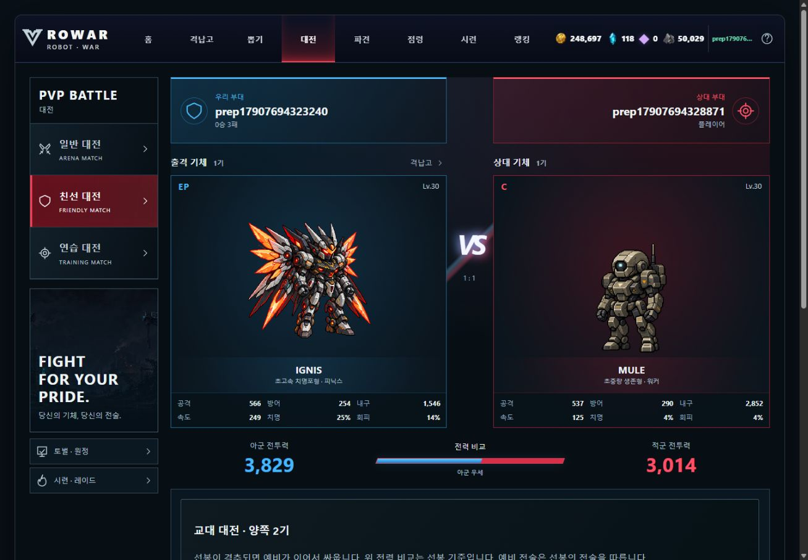
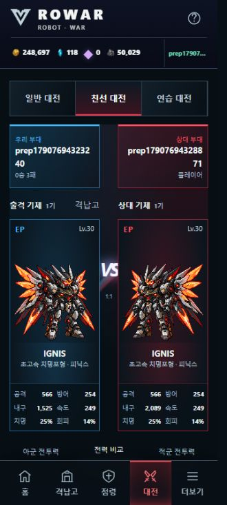
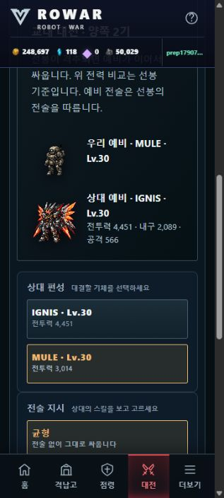

# 대전 준비 수치 · 숙련 목표 정산 완료

작업 위치는 `codex/ui-integration`, 시작 커밋은 `bb8da27`이다. 원격 확인 시 운영 main은 `ab45b4c`, 원본 UI는 `29733c9`로 추가 반입이 없었다. 사용자 “다음작업 시작” 지시에 따라 직전 출시 검수의 두 서버 계약을 통합 지원 범위로 CONTRACT에 먼저 기록하고 구현했다. 화면은 GPT 주도, 운영 main 서버는 Claude 주도를 유지한다. Claude에게 외부 메시지를 보내거나 main·원본 UI를 수정하지 않았다.

## 대전 준비 계약

- `server/arena.js`: 방어 기록에서 선택한 주력의 정규화된 `circuit`을 전달한다. 기존 `stats`와 예비 스냅샷을 유지한다.
- `server/battle.js`: find/next의 `opponent.stats`, `opponent.circuit`, 예비의 `skillLv/parts/slots/circuit/stats`를 추가한다. 등록된 player는 저장된 확정 스냅샷을 사용하며, 구 밸런스는 기존 재계산 경로를 유지한다. 생성 상대의 준비·시작은 같은 계산을 쓴다. BOSS 토벌은 합동 보정을 적용한 stats를 준비 응답으로 보낸다.
- 같은 pending의 준비 stats는 start의 `statE` 또는 `boss.stats`, 예비는 `relay.statE2`와 일치한다. 찾은 뒤 상대가 방어 기록을 갱신해도 이미 잡은 상대의 입력은 바뀌지 않는다. 공개 준비 응답에 계정 DB ID·시드·상대 전술을 추가하지 않았다. 난수 소비·보상·비용·전술 규칙을 바꾸지 않았다.
- `js/ui/battle-stats.js`, `js/game.js`: 여섯 기본 능력치의 유효성을 확인하고 확정 stats로 카드·전투력·상대 분석·토벌 보스 표시를 만든다. 이전 응답에서 player의 stats/circuit이 둘 다 없으면 계속 미확인이다. 예비의 전투력·내구·공격을 표시하고 `themes/battle-v2.css`에서 좁은 화면 줄바꿈을 맞췄다. 전투 기체는 기존 정지 PNG다.

검사 중 별도 기존 결함을 재현했다. circuit take 후 state에는 새 별이 있지만 아레나 방어 기록에는 이전 별이 남았다. 편성 저장 전까지 준비 circuit=[]이었다. 지원 범위를 CONTRACT에 추가한 뒤 `server/refine.js`의 take/reset 성공 시 `registerArena`를 호출했다. 별 선택·비우기 비용은 동일하고, 성공 응답 전에 새 방어 기록을 저장한다. 테스트에서는 편성 재저장이나 수동 registerArena 없이 두 경로의 갱신을 확인한다.

## 목표 변경 · 정산 계약

`server/mastery.js`의 공통 조건부 정산을 state GET과 shop goal POST가 사용한다. 현재 player의 items/m_goal/rev와 ID순 기체의 id/type/level/m_lv를 비교하고, 일치할 때만 보관함·목표를 갱신한다. 기체 목록은 JSON 한 인자로 비교하므로 기체 수가 늘어도 바인딩 수는 최대 9개다. 같은 batch의 두 번째 문장은 첫 문장이 한 player를 갱신했을 때만 기체 정산 레벨을 올린다. 충돌은 최신 player·robot을 읽어 최대 3회 계산하고, 계속 충돌하면 HTTP409 `mastery changed, retry`다. `server/worker.js`는 state의 오류를 성공 응답으로 감싸지 않는다.

이 방식은 [D1 batch의 순차 실행·트랜잭션·실패 롤백 계약](https://developers.cloudflare.com/d1/worker-api/d1-database/)과 [SQLite changes()의 직전 변경 수](https://www.sqlite.org/lang_corefunc.html#changes)에 따른다. 실제 SQLite 및 로컬 D1에서 조건 실패·정산 레벨 미갱신·전체 롤백을 확인했다.

goal POST는 **현재 미정산 보상을 기존 유효 목표로 지급한 후 새 목표를 설정**한다. 반환 `items/goal/rev/mastery`는 새 목표 기준이며 `mastery.got=0`, 추가 `settled:{goal,got,grants}`는 이번에 지급한 이전 목표 기준이다. 기존 목표가 보유로 무효화됐다면 기존 공유 autoGoal 규칙을 따른다. 목표가 잘못됐으면400이며 지급/목표/정산 레벨을 쓰지 않는다. 같은 목표·보상 없는 요청은 저장하지 않는다.

state GET 정산은 기존처럼 rev를 올리지 않는다. 최초 자동 목표 설정으로 rev0이 사라지면 새 계정의 기존 저장 이관을 막기 때문이다. goal POST에서 실제 변경이 있을 때는 rev를 1 올린다. DB 스키마24, 이미 이관된 기체의 소급 없음, 만렙 조각 보너스는 유지한다.

`js/ui/development-manager.js`는 변경 전 조회와 변경 후 확인을 유지하면서, 성공 POST의 확정 items를 보관하고 `settled.goal` 이름으로 지급을 알린다. 후속 조회 실패에도 확인된 지급은 유지한다. 요청 중 로컬 items가 바뀌었거나 계정/상태 소유자가 바뀌면 늦은 응답으로 덮어쓰지 않는다. shop의 부분 응답을 서킷 지갑 관리기에 전달하지 않아 정제 코어 표시를 지우지 않는다. 소비 재화나 기체 레벨을 부분 응답으로 되돌리지 않는다.

## 검증

관련 검사 15종 통과:

```text
mastery-concurrency-check · preparation-check · refinecheck
masterycheck · battlecheck · codexcheck · presetcheck · shopcheck
development-ui-check · battle-ui-check · combat-integration-ui-check
relaycheck · loadout-ui-check · shard-ui-check · launch-ui-check
```

- 실제 SQLite: 변경 직전 Lv.4→5는 mule+1/dune0, 다음 Lv.10은 dune+1. 동시 GET 지급 합계1, items/goal/level/m_lv/신규 보유 기체 인터리빙, 실제 조각 합성·조립과의 인터리빙, 3회 충돌409, 두 번째 SQL 강제 실패의 rollback, 계정 격리, null m_lv·만렙·이관·78기체 목록을 확인했다. 회수/뽑기 각각을 겹친 전용 인터리빙 검사는 하지 않았으며 모든 서버 쓰기의 원자화를 완료했다고 주장하지 않는다.
- 준비 검사: 신/구 밸런스, 선택0/1, 등록 이후 방어 변경, next/start, 예비, 생성 상대·비상 출격·일반 토벌·합동 보스. 실제 game 어댑터가 서버 확정 stats를 채택하고 구 응답은 미확인으로 남는 것도 검사했다.
- 격리 Worker/D1 `127.0.0.1:8843`, `.wrangler/launch-review-state`: `launch-api-check` 최종32회 + `preparation-api-check`39회 = HTTP71회 통과. 실제 두 서킷 편성·예비·take/reset 자동 방어 갱신, 목표 변경 창과 동시 상태 GET을 확인했다. launch 검사에서 합법적인 전선 패배에도 첫 보상이 지급되지 않음을 확인하고 최대10번 안의 최초 승리 보상/재도전 중복 지급 없음도 검사한다. 이관 없는 신규 게스트·Lv.3·재접속 검증을 유지한다.
- 브라우저: 대문 직접 로그인 → 친선 대전 → 상대 IGNIS 확인 → MULE 선택 전환. 선봉·예비의 확정 숫자가 표시된다. 요청1440×1000의 실효1321×917, 요청360×800의 실효330×734에서 확인했다. 모바일 document clientWidth/scrollWidth가316/316이고 예비 숫자가 줄바꿈된다. 콘솔 error0, 뷰포트 복원. 실제 휴대폰 테스트는 아니다.
- `npm run build` 통과. data/공유 규칙·기체 에셋·스키마·wrangler 설정 변경 없음. `PART_BIND.on=false`, `LINEAGE.gate=false` 유지. 로컬 DB/SQL/dist/테스트 계정은 Git에 넣지 않는다.

캡처:





## 재개 · 남은 작업

1. 실제 Android/iOS·저사양 PC의 터치/키보드/스크롤/장시간 전투 재생·프레임/메모리를 검수한다. 연결된 실기기가 없으므로 완료로 표시하지 않는다.
2. 최종 출시 점검 뒤 사용자의 별도 지시에 따라 main 반영·운영 배포·귀속/계보 스위치 활성화를 결정한다. 이번 통합 브랜치는 운영에 적용하지 않았다.
3. 회사에서 작업할 때 경로·브랜치·dirty/upstream을 먼저 확인하고 `codex/ui-integration`만 갱신한다. Claude가 main에서 같은 서버 범위를 작업했다면 CONTRACT와 이 통합 커밋을 대조해 중복 반입을 피한다.

로컬 실행:

```powershell
npm run build
node node_modules/wrangler/bin/wrangler.js dev --ip 127.0.0.1 --port 8843 --persist-to .wrangler/launch-review-state
node --no-warnings tools/mastery-concurrency-check.mjs
node --no-warnings tools/preparation-check.mjs
node --no-warnings tools/launch-api-check.mjs http://127.0.0.1:8843
node --no-warnings tools/preparation-api-check.mjs http://127.0.0.1:8843
```

빌드 전에 이 checkout의 로컬 Worker를 종료한다. API 검사는 격리 DB에서만 1회용 계정을 생성하며 원격 DB를 사용하지 않는다. 과거 출시 검수의 서버 미완료 항목은 이번 기록으로 대체한다.
